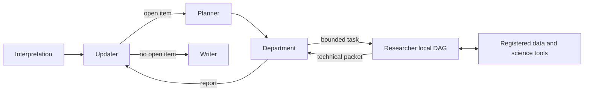

# DeepResearcher · Scientific Research Agents


**English** · [简体中文](README.zh-CN.md)

A local research prototype for turning scientific questions into bounded technical investigations, then updating conclusions from traceable evidence. The main implementation separates **Interpretation, Updater, Planner, Department, Researcher and Writer (I/U/P/D/R/W)**. A later **fixed-U** variant evaluates competing explanations through parallel, frozen argument trees.

## 🔬 Research question

How can an LLM agent choose analyses and revise its understanding while keeping the research question, technical execution and scientific interpretation under distinct authority? The motivating application is geochronology: read registered tables, choose statistical analyses, inspect alternatives and retain the boundary between an observed distribution and its geological explanation.

The project implements scoped role inputs, R-authored execution DAGs approved by D, runtime-derived evidence references, and scientific tools over read-only data sources. These are implemented research mechanisms; their effect on answer quality has not been established by a controlled benchmark.

## 🧭 Two research configurations

|Configuration|Organization|Entry point|
|---|---|---|
|**Mixed / six-role mainline**|I fixes scope; U revises the epistemic map; P selects an open item; D issues one task; R executes its approved local DAG; D reports; U revises; W writes when no open item remains.|[mix_epistemic_research_agent.py](src/mix_epistemic_research_agent.py)|
|**Fixed-U / latest local variant**|U freezes competing explanations C; each D freezes technical tasks T; C projects and T tasks fan out; ready R stages can run in parallel; D assessments feed U's common evidence matrix and W's final adjudication. P is no longer a model role.|[fixed_u_epistemic_research_agent.py](src/fixed_u_epistemic_research_agent.py)|



The diagram describes the mixed graph. See [methods and version differences](docs/methods.md) for the fixed-U fan-out and the changed Writer responsibility.

## ⚙️ Quick start

From the repository root, with Python 3.12 and `uv` installed:

```bash
uv sync --locked
uv run --locked python -B -m examples.offline_protocol
uv run --locked python -B -m examples.offline_science
uv run --locked python -B -m unittest discover -s work -p 'test_*.py'
uv run --locked python -B scripts/check_repository.py
```

The protocol example runs the preserved fixed-U graph with the original scripted model/tool fixture: two explanation projects, two technical packets and a two-row evidence matrix reach W. The science example performs actual database query, inverse-variance weighted-age and KDE calculations on six synthetic rows; its expected weighted age is **103.0 Ma**. Both examples are offline. Fixture-generated scientific text is demonstration content.

## 🧪 Evidence and results

Three kinds of evidence are kept separate:

|Evidence|What it demonstrates|Artifact|
|---|---|---|
|Original automated checks, rerun locally|Role boundaries, task binding, DAG authorization, dependency-scoped context, provenance and numerical tools|[Validation record](docs/validation.md)|
|New offline examples|Actual graph assembly and tool calculations using small public synthetic inputs|[Examples](examples/), [recorded outputs](evidence/)|
|Historical live trace audit|A mixed checkpoint continuation reached Writer; later mixed and fixed-U runs also expose concrete failure cases|[Historical run summary](docs/experiments.md), [machine-readable audit](evidence/historical_runs.json)|

The completed continuation contains 88 completed task nodes and a nonempty 2,513-character Writer answer. Its launch question differs from the recovered task constitution, so the recovered state governs its interpretation. No historical trace is cryptographically tied to the exact current source revision. There is no benchmark accuracy or independently validated geological discovery reported here.

## 🧰 Scientific analysis substrate

The preserved infrastructure wraps existing local Source/Data/Tool registries as LangChain tools executed by LangGraph `ToolNode`. It supports table/schema inspection, filtering, aggregation and relational operations; explicit scientific field binding; weighted ages, KDE, mixture models, unimodality tests, change points, bootstrap, spatial analyses and bias diagnostics. Physical tool results are stored in an objective ledger; technical packets and departmental reports link back to runtime identities.

SQLite and tabular workbooks are external inputs. This repository contains no private observation databases, downloaded papers or large run logs. The substrate also retains an optional temporary Python operation facility, disabled by default in the new live launcher; see [data and tools](docs/data_and_tools.md) for its actual isolation boundary and optional tool dependencies.

## ▶️ Running with a model

The live launcher requires explicit provider, model, question and database arguments. Credentials come from the selected provider's environment variables; `.env.example` is a blank template and is not auto-loaded.

```bash
uv run --locked python -B -m examples.run_agent --help
uv run --locked python -B -m examples.run_agent \
  --variant mix --provider deepseek --model YOUR_MODEL \
  --database data/private/observations.sqlite \
  --question 'Within the registered table, describe the age distribution and its limits.'
```

Each launch creates a fresh directory under `runs/local/` containing a checkpoint, semantic trace and, if completed, `answer.md`. The command sends selected local context to the configured model service. It was **not executed against a live API during repository preparation**. [Running guide](docs/running.md) covers variant selection, data setup, persistence and optional operations.

## 🗂️ Repository map

```text
src/                         Preserved agent modules and scientific substrate
work/test_*.py               Preserved original offline tests and shared fixtures
work/lightweight_*.py        Preserved semantic trace observer
examples/                    Added offline demonstrations and explicit live launcher
docs/                        Methods, tools, experiments, running and validation
evidence/                    Small sanitized summaries and verification outputs
provenance/                  Source hashes and copy/edit boundaries
scripts/                     Added local repository checks
```

The test directory retains its historical `work` name because the original tests share fixtures through `work.*` imports. The older thin agent and the substrate's original workflow modules remain for compatibility and provenance; they are not the advertised six-role entry point.

## 📚 Provenance and reuse

This is an independent showcase snapshot. Original research files and experiment artifacts remain outside it. All copied files are listed in the [source manifest](provenance/source_manifest.json); the only intentional source edit replaces personal default data paths with a portable data directory. New launchers, examples, documentation and checks are identified in [provenance](docs/provenance.md).

The scientific orchestration is local project code built on LangGraph, LangChain and established numerical libraries. File presence and hashes establish implementation and snapshot identity; they do not establish sole personal authorship. Neither source directory has an independent Git history, so this repository does not invent contribution commits. Author attribution, third-party redistribution rights and the final license remain for owner confirmation before publication. See [THIRD_PARTY_NOTICES.md](THIRD_PARTY_NOTICES.md).
