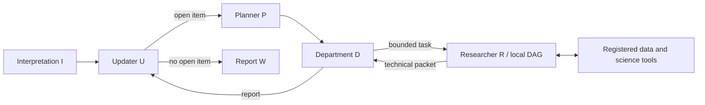

# Ariadne

**Exploring Scoped Authority and Recoverable Execution in Long-Horizon Research Agents.**

**English** · [简体中文](README.zh-CN.md)

Ariadne is a multi-agent research prototype for long-horizon scientific investigation, with geochronology database analysis as its main application. It turns questions into data investigations and scientific calculations, accumulates evidence, and uses that evidence to revise understanding and produce a report.

The central question is: **When research involves many dependent steps, how can information loss between agents be reduced, local errors be contained, and execution remain inspectable, correctable and recoverable?** The architecture draws on separation of responsibilities, delegated authority and feedback to assign different decision boundaries to scientific interpretation, research planning, technical execution and evidence management.

## 1. Motivation: Error Accumulation and Information Loss

### 1.1 How can local errors enter later decisions?

A scientific analysis often begins by defining the object of study, querying and selecting data, choosing methods and running calculations, then deciding what to investigate next. These steps depend on one another: an interpretation at one stage can become a premise for the next.

For example, if an early age-distribution peak is directly interpreted as a geological event, later planning may search for evidence around that event and gradually treat the unverified interpretation as established. Subsequent calculations could each execute correctly while the investigation continues from an incorrect premise.

The project examines this gap between local task capability and long-horizon reliability. Relevant problems include goal drift, repeated investigation, unchecked conclusions re-entering context, and difficulty determining which completed work remains valid after an error.

Multi-agent collaboration also involves lossy transmission. As tasks pass through delegation, execution and reporting, repeated reformulation can compress or omit research goals, scope conditions and key evidence. Later decisions may therefore receive altered information even when an individual step produces no incorrect answer.

### 1.2 Why use asymmetric roles?

Giving every node planning, execution, evaluation and delegation capabilities is a flexible recursive design. For scientific work, my concern is the decision boundary: whether technical execution may reinterpret the research goal, when a local result can update scientific understanding, and at which level an error should be corrected.

Ariadne therefore gives roles different information, authority and output responsibilities. The research layer decides what to investigate; the technical layer decides how to carry out an authorized investigation; evidence records preserve the basis connecting them. The design makes explicit what each role may change so that its outputs can be checked.

This asymmetric structure also explores whether information loss at role boundaries can be reduced: explicit task constraints preserve research intent, structured result packets carry conclusions and their scope, and retrievable tool records reduce reliance on successive natural-language summaries.

## 2. Core Design: Boundaries for Different Decisions

### 2.1 Separate research decisions from technical execution

Deciding whether to compare two age populations differs from choosing fields and statistical parameters. Assessing whether the difference supports a geological interpretation requires a further evidential judgment.

Execution roles choose tools, methods and local steps within an assigned task, while upstream roles constrain the research scope. Upstream roles also avoid specifying every low-level parameter, preserving useful technical autonomy.

### 2.2 Keep calculation records and scientific interpretation distinct

A peak returned by KDE is a calculation result; interpreting it as a tectonic event is a scientific judgment requiring evidence. The project separately retains objective tool records, technical packets and higher-level research state, allowing later roles to inspect inputs, calculations and scope.

Runtime provenance links references to tool calls that actually occurred. Roles describe what results mean; code binds those descriptions to existing records, so later decisions can inspect more than the preceding agent's prose summary.

### 2.3 Allow local correction and recovery

Researcher-authored local DAGs require Department approval. Tool parameters can be repaired during execution; changes to DAG topology require a new proposal and approval. Plan patches cannot silently rewrite completed stages.

Stage dependencies, separate evidence records and checkpoints allow completed work to be retained while an investigation continues or a failure is handled locally. Whether a recovered state still matches the intended task is a separate check.

## 3. Mainline Architecture: I / U / P / D / R / W

The Mixed mainline uses six functional roles. They share a research task but receive different inputs and carry different decision responsibilities.

### 3.1 Asymmetric Architecture: Context Boundaries and Decision Authority

Ariadne's asymmetry is not simply a matter of assigning different prompts to different agents. Through role-specific state projections, structured inputs and outputs, and runtime-enforced authority boundaries, each role makes decisions at a different level of the same research task.

**Different roles neither need identical context nor should have identical authority to modify the research state.**

| Role | Context received | Autonomy and limits | Output |
|---|---|---|---|
| **I — Interpretation** | Original user question; the runtime attaches the epistemic policy | Defines the research object, boundaries, and requested output; does not design the technical execution plan | `InquiryConstitution`, the research constitution |
| **U — Updater** | Research constitution; in subsequent cycles, the prior epistemic snapshot and newly returned D report | Updates supported findings, uncertainty, and open questions; does not execute calculations | `EpistemicSnapshot`, the current research understanding |
| **P — Planner** | Research constitution and U's epistemic snapshot | Selects one existing open item to investigate; does not invent new items or prescribe tool parameters | `selected_item_id`, the selected investigation item |
| **D — Department** | Selected local item, research constitution, and R's capability envelope; subsequently, R's plan and technical results | Sets task scope and acceptance criteria and reviews R's local DAG; does not author R's technical plan | `TechnicalTask`, `DPlanReview`, `DepartmentReport` |
| **R — Researcher** | D-issued technical task, registered data sources and tools, approved local DAG, and execution results within the current stage's dependencies | Selects algorithms, tools, parameters, and local steps within the authorized task; cannot unilaterally change the research goal or approved DAG topology | Execution plan, tool-call records, `TechnicalResults` |
| **W — Writer** | Research constitution and U's current epistemic state | Produces the final report from existing evidence; does not launch an independent investigation | `WriterOutput` |



#### Why restrict context?

If every node reads the entire history, later roles may encounter transient information unrelated to their current task or treat unverified interpretations as established premises. Ariadne therefore distinguishes three kinds of information:

- **Research constraints:** The research object, task boundaries, and open questions are carried through explicit task identities.
- **Local execution information:** A technical stage receives data and results according to its local DAG dependencies; transient reads from sibling stages are not automatically included.
- **Evidence records:** Objective tool-call records are stored separately and linked by identity to technical packets, department reports, and the epistemic state. Each role need not replay every raw trace.

The aim is to preserve two kinds of autonomy at once: **upstream roles govern research direction and evidence interpretation, while downstream roles retain freedom to choose technical methods.**

#### How does a task cross these information boundaries?

Consider comparing age distributions across different lithologies in a region.

I fixes the research object and data scope. U identifies unresolved comparison questions. P selects one of those questions. D turns it into a technical task with explicit acceptance criteria. R independently chooses how to filter samples, compute age statistics, and test robustness.

R's numerical outputs do not become scientific conclusions directly. D first summarizes their technical basis and interpretive limits, then U updates the research state. W prepares the final report only when that state meets the termination condition.

The design separates **technical autonomy, scientific interpretation, and evidence-write authority**, while using structured handoffs to preserve critical constraints.

### 3.2 Researcher's local autonomy

R first claims the exact task issued by D, then proposes a finite technical DAG with stage objectives and dependencies. D reviews its scope; R retains the choice of tools, algorithms and parameters. Each U/P cycle yields one D task, and further investigation requires another research-decision cycle.

### 3.3 Select context by task dependencies

A stage primarily receives results from its DAG dependencies; transient data from sibling stages do not automatically enter its context. Complete execution records remain available for audit without replaying the entire history at every call. The Fixed-U executor further packages stage results for parallel consumption by ready workers.

### 3.4 How does evidence move between roles?

The main chain is **tool call → objective record → technical packet → department report → research state → final report**. Runtime code binds call, task, packet and report identities. Higher-level roles can reference completed analyses while preserving uncertainty and the scope of their conclusions.

[Mainline implementation](src/mix_epistemic_research_agent.py) · [Role contracts and methods](docs/methods.md)

## 4. Fixed-U: Parallel Analysis Within a Fixed Research Framework

### 4.1 What is fixed, and which problems is it intended for?

The defining choice is that **U initializes a research framework that is not iteratively updated during that execution**. It specifies the explanations to assess and their evidence requirements, then investigations proceed within this scope without reopening the research agenda after every local result.

The intended focus is work with an established research paradigm but substantial scientific value when carried through systematically. For example, known explanations and evidence dimensions may need to be assessed against a new data scope for support, counterevidence and robustness. Research value can come from applying a mature paradigm to more data and organizing analyses that would otherwise require substantial manual work.

The framework stays fixed while conclusions remain evidence-dependent. R still chooses methods and makes local repairs within D's task boundaries. The aim is to complete an investigation within a clear paradigm, without requiring every run to keep generating new research directions.

### 4.2 How does the current implementation execute?

U generates a finite set of competing explanations C once. For each explanation, D creates a fixed technical-item table T covering support, counterevidence, discrimination or robustness. C projects, T tasks and dependency-ready R stages can run in parallel. Deterministic routing replaces P's model-based selection role.

```text
I fixes scope → U initializes and freezes explanation set C
  → each D fixes technical items T → R executes an approved local DAG
  → D assesses explanations → U normalizes an evidence matrix → W judges and writes
```

The final U step normalizes the evidence matrix, retaining support, counterevidence, discriminative value and uncertainty for each explanation. It does not rewrite C, add T items or start another planning cycle. Updating the research framework during execution is distinct from aggregating evidence after completion. Fixed-U's W makes the final judgment from the matrix; Mixed's W mainly publishes the research state already formed by U.

[Fixed-U implementation](src/fixed_u_epistemic_research_agent.py) · [Structure and role differences](docs/methods.md#fixed-u-frozen-research-framework-and-parallel-assessment)

## 5. Application: Long-Horizon Analysis of Scientific Databases

Geochronology is the main experimental setting. Investigations begin with registered databases and tables: inspect data and fields, define the sample scope, bind scientific roles such as age, uncertainty and coordinates, then run analyses and interpret their scope.

The scientific substrate provides:

- **Data operations:** table/schema inspection, filtering, sampling, aggregation and table relations.
- **Temporal statistics:** weighted ages, KDE, mixture models, unimodality tests, change points and bootstrap.
- **Spatial and bias analysis:** spatial regression, clustering, leave-one-region/source-out checks and uncertainty diagnostics.
- **Result tracing:** link selected data, parameters, returned values and failures to actual calls.

For a regional age-distribution investigation, selected data can be passed to statistical tools through `input_from`, with physical fields bound explicitly through `source_fields`. This makes it possible to inspect which records were used and whether an interpretation exceeds what those records support.

See [ScientificInfrastructure](src/scientific_infrastructure.py) and [Data and tools](docs/data_and_tools.md). The earlier source package also retains `TotalTreeXlsxSource`, an interface to linked literature-extraction tables. A complete extraction-to-research-conclusion workflow still requires independent validation.

## 6. Execution Records and Current Limitations

The repository retains original automated checks, small offline examples and sanitized summaries of historical live-model traces.

| Material | Observed execution |
|---|---|
| 64 original automated tests | Role/task binding, DAG approval, dependency-scoped context, parallel reduction, provenance and selected numerical tools |
| Fixed-U offline protocol example | Two explanation projects produce two technical packets and a two-row evidence matrix, reaching W |
| Offline scientific calculation | Actual query, weighted-age and KDE calls on six synthetic rows; weighted age is 103.0 Ma |
| Historical Mixed checkpoint continuation | 88 completed task nodes and a nonempty Writer answer; node counts include nested graph tasks |
| Historical failures | Invalid local DAG dependencies, incomplete technical stages and executions that did not reach Writer |

Protocol models are scripted fixtures for checking execution mechanisms; the calculation example uses synthetic data. Historical live calls have their own checkpoint context: one completed continuation's launch question differs from its recovered task state, so that state governs interpretation. The traces also lack a source-version hash tying them to the current code.

These materials establish implemented mechanisms and execution records. They do not yet establish a controlled Mixed-versus-Fixed-U comparison of scientific correctness, cost or reliability. Checkpoints preserve state; task consistency after recovery, plan validity and scientific interpretation still require checks.

[Historical experiments](docs/experiments.md) · [Local validation](docs/validation.md)

## 7. Future Research

The next evaluation should fix questions, data scopes and model configurations, then examine how authority boundaries, context projection and recovery affect long tasks: which later decisions inherit an error, whether valid work survives a failure, whether the system repeats investigations or drifts from the original goal, and how completion quality trades off against execution cost.

Mixed and Fixed-U represent different research organizations. The former can revise the agenda in response to evidence; the latter completes an investigation within a fixed framework. Comparisons need to consider task fit as well as the observable benefit of the added mechanisms.

## 8. Engineering and Running the Code

### 8.1 Technical foundation and implemented modules

The implementation uses **Python 3.12, LangGraph and LangChain**. Frameworks provide model and graph-execution interfaces; project code implements role contracts, state projections, task authorization, provenance binding and scientific-tool organization.

| Engineering area | Foundation | Implemented work |
|---|---|---|
| Hierarchical orchestration | LangGraph `StateGraph`, subgraphs, `Send` | Mixed outer loop, R local graph, and Fixed-U project/task/ready-stage fan-out and reduction |
| Models and structured interaction | LangChain, ChatDeepSeek, ChatOpenAI-compatible adapters, schema checks | Structured role outputs, tool calls, provider selection and request-retry boundaries |
| Scientific data access | SQLite, CSV, Excel; DuckDB/pandas | Registered read-only sources, schema inspection, bounded query/aggregation/relations and explicit scientific field binding |
| Scientific tools | NumPy, SciPy, scikit-learn, statsmodels and related libraries | Established numerical methods registered with input requirements and result status, linked to upstream data |
| Execution control and evidence | Task identities, local DAGs, runtime records | Task claims, D approval, dependency-scoped context, plan revision and tool-to-report provenance |
| Persistence and observation | LangGraph checkpoints, `SqliteSaver`, JSONL semantic traces | State persistence, node input/output, tool/status/timing records, checkpoint integration and historical continuation analysis |

The showcase additionally supplies locked dependencies, offline entry points, an explicit live launcher and local repository checks. Role orchestration and scientific tools are research implementations; these launch and verification interfaces make that implementation easier to inspect and run.

### 8.2 Offline execution

Install Python 3.12 and [uv](https://docs.astral.sh/uv/), then run from the repository root:

```bash
uv sync --locked
uv run --locked python -B -m examples.offline_protocol
uv run --locked python -B -m examples.offline_science
uv run --locked python -B -m unittest discover -s work -p 'test_*.py'
uv run --locked python -B scripts/check_repository.py
```

Neither example calls a model service. The protocol example runs the actual Fixed-U graph with a scripted model; the science example executes data and numerical tools. Optional plate-reconstruction, R and other external-analysis interfaces require separate runtimes. See [Data and tools](docs/data_and_tools.md) for validation scope.

### 8.3 Model-backed execution and run artifacts

Live execution requires an explicit provider, model, question and database, plus the corresponding credentials:

```bash
uv run --locked python -B -m examples.run_agent --help
uv run --locked python -B -m examples.run_agent \
  --variant mix --provider deepseek --model YOUR_MODEL \
  --database data/private/observations.sqlite \
  --question 'Analyze the age distribution and its evidential limits within the registered tables.'
```

Use `--variant fixed-u` for the fixed-framework configuration. Each launch creates a new directory under `runs/local/`, containing `checkpoint.sqlite`, `trace.jsonl` and, on completion, `answer.md`. The underlying graph accepts a checkpointer; the showcase launcher starts a fresh run by default rather than reusing an old task. See [Running](docs/running.md) for model/data configuration, recovery and optional temporary Python operations. No live model API was called for this documentation revision.

### 8.4 Main files and provenance

| Path | Contents |
|---|---|
| [`src/mix_epistemic_research_agent.py`](src/mix_epistemic_research_agent.py) | I/U/P/D/R/W mainline |
| [`src/fixed_u_epistemic_research_agent.py`](src/fixed_u_epistemic_research_agent.py) | Fixed-framework parallel variant |
| [`src/scientific_infrastructure.py`](src/scientific_infrastructure.py) | Agent interface to data and scientific tools |
| [`src/scientific_research_agent/`](src/scientific_research_agent/) | Retained scientific data, computation and evidence substrate |
| [`work/`](work/) · [`examples/`](examples/) | Original tests, semantic trace observer and run examples |
| [`docs/`](docs/) · [`evidence/`](evidence/) | Methods, operation, validation and small sanitized records |

Original tests share fixtures through `work.*`, so that directory name is retained. Full research runs require external data and model configuration; private databases, large checkpoints and raw traces are not distributed. See [Provenance](docs/provenance.md) for source identity and preparation boundaries, and [Third-party Notices](THIRD_PARTY_NOTICES.md) for dependencies and reuse.

Configuration: [Environment variables](docs/security.md).
