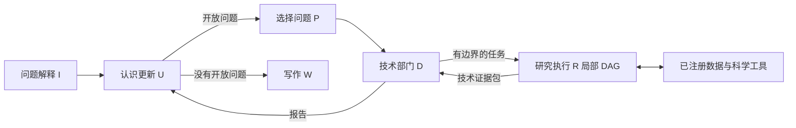

# DeepResearcher · 科学研究智能体


[English](README.md) · **简体中文**

面向本地科学数据库的研究原型：把问题转成有边界的技术调查，再依据可追溯证据更新科学认识。主线使用 **Interpretation、Updater、Planner、Department、Researcher、Writer（I/U/P/D/R/W）** 六层结构；后续 **fixed-U** 变体采用冻结的竞争解释树并行开展评估。

## 🔬 研究问题

如何让大模型自主选择分析方法、修订认识，同时明确研究范围、技术执行和科学解释各自的权限？项目以地质年代学为应用场景：读取已登记表格，选择统计分析，检验替代解释，区分数据中观察到的分布与其地质解释。

代码实现了角色输入投影、R 自主编写而由 D 审核的局部执行 DAG、运行时生成的证据引用，以及只读数据源上的科学分析工具。这些机制已经实现；它们对回答质量的影响尚无受控基准实验结论。

## 🧭 两种研究配置

|配置|组织方式|实际入口|
|---|---|---|
|**Mixed／六层主线**|I 固定问题边界；U 更新认识图；P 选择开放问题；D 签发一个技术任务；R 执行获准的局部 DAG；D 报告；U 再更新；没有开放问题时进入 W。|[mix_epistemic_research_agent.py](src/mix_epistemic_research_agent.py)|
|**Fixed-U／本地最新变体**|U 冻结竞争解释 C，各 D 冻结技术事项 T；C 项目、T 任务和就绪的 R 阶段可以并发；D 评估汇入 U 的统一证据矩阵，再交 W 最终裁决。P 不再是模型角色。|[fixed_u_epistemic_research_agent.py](src/fixed_u_epistemic_research_agent.py)|



上图对应 mixed 主线。fixed-U 的并发结构和 Writer 职责变化见[研究方法与版本区别](docs/methods.md)。

## ⚙️ 快速运行

安装 Python 3.12 和 `uv` 后，在仓库根目录执行：

```bash
uv sync --locked
uv run --locked python -B -m examples.offline_protocol
uv run --locked python -B -m examples.offline_science
uv run --locked python -B -m unittest discover -s work -p 'test_*.py'
uv run --locked python -B scripts/check_repository.py
```

协议演示使用原有脚本化模型／工具夹具，运行真正的 fixed-U 图：两个解释项目生成两个技术包和两行证据矩阵，最终到达 W。科学工具演示则在六行合成数据上实际执行查表、逆方差加权年龄和 KDE，预期加权年龄为 **103.0 Ma**。两者均离线运行；夹具中的科学文字只用于协议演示。

## 🧪 证据与结果

|证据类型|能够说明什么|对应材料|
|---|---|---|
|重新执行的原有自动检查|角色边界、任务绑定、DAG 审核、依赖范围内的上下文、证据归属及数值工具行为|[验证记录](docs/validation.md)|
|新增离线演示|小型合成输入上的真实图运行和科学工具计算|[演示入口](examples/)、[保存输出](evidence/)|
|历史真实调用轨迹核查|mixed 的一次断点续跑到达 Writer；后续 mixed 和 fixed-U 记录也暴露了具体失败情形|[实验说明](docs/experiments.md)、[结构化摘要](evidence/historical_runs.json)|

已完成的续跑记录包含 88 个完成的任务节点，以及非空的 2,513 字符 Writer 回答；其启动问题与恢复任务的 constitution 不同，因此应按恢复状态理解该记录。历史轨迹没有绑定当前源码版本的哈希。本仓库没有报告基准准确率，也没有把自动生成的地质结论作为独立验证的科研发现。

## 🧰 科学分析底座

保留的基础设施将已有 Source／Data／Tool 注册体系封装为 LangChain 工具，由 LangGraph `ToolNode` 执行。它包括表格与字段检查、筛选、聚合和关系操作、显式科学字段绑定，以及加权年龄、KDE、混合模型、单峰性检验、变点、bootstrap、空间分析和偏差诊断。客观工具结果进入 objective ledger；技术包与部门报告沿运行时身份关联。

SQLite 和工作簿是外部输入，展示仓库不包含私有观测数据库、下载论文或大体积运行日志。原始底座还保留临时 Python 操作能力，新增真实运行入口默认关闭该能力；其实际隔离边界和可选依赖见[数据与工具](docs/data_and_tools.md)。

## ▶️ 接入真实模型

运行入口要求显式提供 provider、model、question 和 database。凭据由选定服务的环境变量读取；`.env.example` 是空白配置模板，不会自动加载。

```bash
uv run --locked python -B -m examples.run_agent --help
uv run --locked python -B -m examples.run_agent \
  --variant mix --provider deepseek --model YOUR_MODEL \
  --database data/private/observations.sqlite \
  --question '在已登记表格范围内，描述年龄分布及其限制。'
```

每次启动在 `runs/local/` 下创建新的目录，保存 checkpoint、语义轨迹以及完成后的 `answer.md`。真实运行会将选中的本地上下文发送给配置的模型服务。**本次仓库整理没有调用真实模型 API**。版本切换、数据接入、持久化与可选操作见[运行说明](docs/running.md)。

## 🗂️ 目录结构

```text
src/                         保留的智能体模块与科学底座
work/test_*.py               原有离线测试及共享夹具
work/lightweight_*.py        原有语义轨迹观察器
examples/                    新增离线演示与显式真实运行入口
docs/                        方法、工具、实验、运行和验证说明
evidence/                    小型脱敏摘要与验证输出
provenance/                  原始来源哈希与复制／修改边界
scripts/                     新增本地仓库检查
```

原测试通过 `work.*` 共享夹具，因此保留 `work` 目录名。较早的 thin agent 和科学底座原有 workflow 模块用于兼容与溯源，展示主线的入口是六层 mixed 版本。

## 📚 来源与复用

这是独立展示快照，原研究代码和实验材料留在原处。所有复制文件见[来源清单](provenance/source_manifest.json)；唯一有意调整的研究源码是把个人默认数据路径改为可配置目录。新增运行入口、演示、文档和检查脚本见[来源说明](docs/provenance.md)。

本地研究代码构建在 LangGraph、LangChain 与既有数值库之上。文件与哈希可以证明实现和快照身份，不能独立证明全部个人贡献。两个源目录都没有独立 Git 历史，因此不会编造提交归属。公开前还需由作者确认署名、第三方再分发权及最终许可证，见[第三方说明](THIRD_PARTY_NOTICES.md)。
