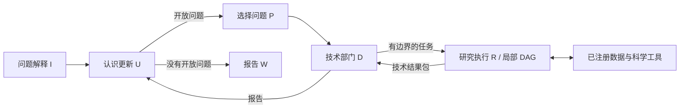

# Ariadne

**探索长程科研智能体中的权限分工与可恢复执行。**

[English](README.md) · **简体中文**

**研究问题：** 长程智能体如何减轻跨角色信息传递损失，并限制局部错误向后续决策传播？**方法：** 在 LangGraph 上采用非对称 I/U/P/D/R/W 角色、经授权的局部 DAG、结构化证据包与检查点执行。**核心发现：** Fixed-U 离线协议完成并行任务与证据归并并到达 Writer；64 项原有测试覆盖角色契约、执行控制与科学工具。

[架构设计](docs/methods.md) · [运行证据](docs/experiments.md)

## 1. 设计动机：错误积累与信息传递损失

### 1.1 局部错误如何进入后续决策？

一次科研分析往往需要先明确研究对象，查询和筛选数据，再选择方法、执行计算，并根据结果决定下一步调查。这些步骤相互依赖，前一步的解释可能成为后一步的前提。

例如，系统若在早期将一个年龄分布峰值直接解释为某次地质事件，后续规划就可能围绕该事件寻找证据，逐渐把尚未证实的解释当成已知条件。此时，即使后续计算分别执行正确，整体研究也可能沿着错误前提继续推进。

我希望研究的，正是局部任务能力与长期任务可靠性之间的差距。除了错误答案，还需要关注目标逐渐偏移、重复调查、未经核查的结论反复进入上下文，以及出错后难以判断哪些工作仍然有效等问题。

多智能体协作还涉及信息传递的损失：任务在委派、执行和汇总中被多次转述，研究目标、适用条件或关键证据可能被压缩或遗漏，即使某一步没有产生错误答案，也可能改变后续决策所依赖的信息。

### 1.2 为什么采用不对称的角色结构？

让每个节点都能规划、执行、评估和继续委派，是一种灵活的递归组织方式。在科学研究中，我更关心它的决策边界：技术执行是否可以重新解释研究目标，局部结果在什么条件下进入上层认识，以及错误出现后应在哪一层修正。

因此，Ariadne 尝试让不同角色拥有不同的信息范围、决策权限和输出责任。研究层决定调查什么，技术层决定如何完成已授权的调查，证据记录则保留两者之间的依据。架构设计的重点是明确每个角色可以改变什么，并据此检查其输出。

这一非对称结构也旨在探索能否减轻跨角色交接中的信息损失：用显式任务约束保留研究意图，用结构化结果包传递结论及其适用条件，并让上层角色能够回查原始工具记录，减少对层层自然语言摘要的依赖。

## 2. 核心设计：为不同决策设置边界

### 2.1 区分研究决策与技术执行

决定是否比较两个年龄群体，与决定查询哪些字段、采用什么统计参数，属于不同层次的决策；判断统计差异能否支持某种地质解释，又需要进一步的证据审查。

系统允许执行角色在给定任务内自主选择工具、方法和局部步骤，同时由上游角色约束研究范围。上游也不直接编写全部底层参数，使技术执行能够保留必要的自主性。

### 2.2 将计算记录与科学解释分开

KDE 返回一个年龄峰值，是计算结果；将其解释为某次构造事件，是需要证据支持的科学判断。项目分别保存工具的客观记录、技术结果包和上层研究认识，让后续角色能够回查实际输入、计算及其适用范围。

证据引用由运行时关联到实际发生的工具调用。角色负责说明结果意味着什么，代码负责将这些说明绑定到已经存在的记录，避免后续只能依赖上一轮的自然语言总结。

### 2.3 为局部修正和恢复保留空间

Researcher 提出的局部执行 DAG 需要先经过 Department 审核。执行中可以修正工具参数；需要改变 DAG 时，必须提交新的计划并重新审批。已完成阶段不能被计划补丁随意改写。

阶段依赖、独立证据记录和检查点，使系统能够保留已完成工作，并在较小范围内继续调查或处理失败。恢复后如何确认任务与状态仍然一致，也是需要单独检查的环节。

## 3. 主线架构：I / U / P / D / R / W

Mixed 主线使用六种功能角色。它们共享研究任务，但接收不同的输入，并承担不同的决策责任。

### 3.1 非对称架构：信息边界与决策权限

Ariadne 的非对称性不只是为不同智能体设置不同提示词，而是通过不同的状态投影、结构化输入输出及运行时权限约束，使各角色在同一个研究任务中承担不同层次的决策。

**不同角色不需要看到相同的上下文，也不应该拥有相同的修改权限。**

| 角色 | 实际接收的上下文 | 自主权与限制 | 输出 |
|---|---|---|---|
| **I — Interpretation** | 用户原始问题；系统认识原则由运行时代码附加 | 确定研究对象、边界和输出要求；不设计技术执行方案 | `InquiryConstitution`，研究任务宪章 |
| **U — Updater** | 研究宪章；后续轮次还包含已有认识快照与新返回的 D 报告 | 更新已知事实、不确定性和开放问题；不直接执行计算 | `EpistemicSnapshot`，当前研究认识 |
| **P — Planner** | 研究宪章、U 的认识快照 | 从已有开放问题中选择一个调查事项；不自行创建新问题或决定工具参数 | `selected_item_id`，选中的调查问题 |
| **D — Department** | 选中的局部问题、研究宪章、R 的能力范围；后续接收 R 的计划与技术结果 | 规定任务范围和验收条件，审批 R 的局部 DAG；不代替 R 编写技术方案 | `TechnicalTask`、`DPlanReview`、`DepartmentReport` |
| **R — Researcher** | D 签发的技术任务、已注册的数据源与工具、获批局部 DAG，以及当前阶段依赖的执行结果 | 在授权范围内选择算法、工具、参数和局部步骤；不能擅自更改研究目标或已批准的 DAG 结构 | 执行计划、工具调用记录、`TechnicalResults` |
| **W — Writer** | 研究宪章和 U 的当前研究状态 | 依据已有证据组织最终报告；不重新发起独立调查 | `WriterOutput` |



#### 为什么限制上下文？

如果每个节点都读取完整历史，后续角色更容易接触到不属于当前任务的临时信息，也可能把未经验证的解释作为已知前提。Ariadne 因此区分三类信息：

- **研究约束：** 研究对象、任务边界和待解决的问题，通过明确的任务身份逐层传递。
- **局部执行信息：** 技术阶段依据局部 DAG 的依赖选择数据和执行结果，并列阶段的临时读取内容不会自动进入其上下文。
- **证据记录：** 工具调用产生的客观记录独立保存，并通过身份引用关联技术结果、部门报告与研究状态，不要求每一层反复读取全部原始轨迹。

这种组织方式希望同时保留两种能力：**上层负责研究方向与证据解释，下层保留选择技术方法的自主权。**

#### 一次任务如何经过不同的信息边界？

例如，研究某区域不同岩性样品的年龄分布差异时：

I 首先固定研究对象与数据范围；U 识别尚未解决的比较问题；P 选择其中一个问题；D 将其转化为有验收条件的技术任务；R 自主决定如何筛选样品、计算年龄统计量及检验稳健性。

R 的计算结果并不直接成为研究结论，而是先由 D 汇总技术依据和解释边界，再交由 U 更新研究认识。只有当研究状态满足结束条件时，W 才组织最终报告。

这一流程的设计目的，是让**技术自主权、科学解释权和证据写入权相互区分**，同时通过结构化交接避免丢失关键约束。

### 3.2 Researcher 的局部自主权

R 先确认 D 签发的任务身份，再提出有限的技术 DAG，说明各阶段目标与依赖。D 审核计划是否处于任务范围内，具体工具、算法和参数仍由 R 决定。每轮 U/P 选择对应一个 D 任务，进一步调查需要进入新的研究决策循环。

### 3.3 按任务依赖选择上下文

当前阶段主要接收其 DAG 依赖所产生的结果，兄弟阶段的临时数据不会自动进入上下文。完整执行记录作为审计材料保存，不要求每次调用都重读全部历史。Fixed-U 的执行器进一步将阶段结果组织为独立数据包，供就绪阶段并行消费。

### 3.4 证据如何逐层传递？

主要证据链为：**工具调用 → 客观记录 → 技术结果包 → 部门报告 → 研究状态 → 最终报告**。运行时负责绑定调用、任务、结果包与报告的身份；上层角色据此引用已经完成的分析，并保留不确定性和结论适用范围。

[主线实现](src/mix_epistemic_research_agent.py) · [角色契约与研究方法](docs/methods.md)

## 4. Fixed-U：固定研究框架下的并行分析

### 4.1 固定 U 的含义与适用问题

Fixed-U 的核心是：**U 初始化研究框架后，在本轮执行中不再迭代更新这一框架。** 它先确定需要评估的解释及证据要求，随后在既定范围内完成调查，不随着每次局部结果重新扩展研究议程。

这一变体更希望聚焦于研究范式已经比较稳定、但系统完成后仍有较高研究价值的问题。例如，已有若干明确解释与证据维度，需要在新的数据范围内系统检查支持、反证和稳健性。研究收益可以来自成熟范式在更多数据上的应用，以及对原本需要大量人工完成的分析进行系统组织。

固定的是本轮研究框架，结论仍由实际证据决定。技术任务内部的方法选择和局部修正仍交给 R，并受到 D 的任务边界约束。这一定位强调在明确范式内把研究做完整，而不是要求每次运行都持续提出新的研究方向。

### 4.2 当前实现如何执行？

U 一次性生成有限的竞争解释集合 C；每个解释下，D 再一次性确定技术事项 T，覆盖支持、反证、解释区分或稳健性等证据维度。C 项目、T 任务及依赖已经满足的 R 阶段可以并行执行，P 的选择过程由确定性路由替代。

```text
I 固定研究范围 → U 初始化并冻结解释集合 C
  → 各 D 固定技术事项 T → R 执行获准的局部 DAG
  → D 提交解释评估 → U 归并统一证据矩阵 → W 判断并写作
```

末端 U 的职责是归并证据矩阵，保留每个解释的支持、反证、区分能力和不确定性；它不会重新改写 C、增加 T 或开启下一轮规划。这里需要区分“执行中更新研究框架”和“完成后汇总证据”。Fixed-U 的 W 根据矩阵作最终判断；Mixed 的 W 则主要发布 U 已形成的研究状态。

[Fixed-U 实现](src/fixed_u_epistemic_research_agent.py) · [结构与职责区别](docs/methods.md#fixed-u-frozen-research-framework-and-parallel-assessment)

## 5. 实际应用：科学数据库上的长期分析

项目以地质年代学为主要实验场景，分析流程从已登记数据库和表格出发。系统先检查数据及字段，明确样品范围，再绑定年龄、误差、坐标等科学角色，执行分析并解释其适用范围。

科学分析底座提供以下能力：

- **数据操作**：表与字段检查、筛选、抽样、聚合及表间关系操作。
- **时间统计**：加权年龄、KDE、混合分布、单峰性检验、变点与 bootstrap。
- **空间与偏差分析**：空间回归、聚类、区域／来源留一检查及不确定性诊断。
- **结果追溯**：将分析使用的数据、参数、返回值和失败状态关联到实际调用。

例如，研究某一区域的年龄分布时，数据筛选结果可以通过 `input_from` 传给后续统计工具，物理字段通过 `source_fields` 显式绑定。这样可以检查计算使用了哪些记录，以及后续解释是否超出了这些记录能够支持的范围。

[科学分析底座](src/scientific_infrastructure.py) · [数据与工具说明](docs/data_and_tools.md)。较早的数据包还保留连接文献抽取表格的 `TotalTreeXlsxSource`；它是抽取与分析之间的接口，完整抽取到研究结论的流程尚需独立验证。

## 6. 实验记录与当前局限

仓库保留了原有自动测试、小型离线示例和历史真实模型轨迹的脱敏摘要。

| 材料 | 已观察到的执行情况 |
|---|---|
| 64 项原有自动测试 | 检查角色任务绑定、DAG 审核、依赖上下文、并行归并、证据关联及部分数值工具行为 |
| Fixed-U 离线协议演示 | 两个解释项目形成两个技术结果包，并归并为两行证据矩阵，最终到达 W |
| 离线科学计算 | 六行合成数据上的实际查表、加权年龄与 KDE；加权年龄为 103.0 Ma |
| 历史 Mixed 检查点续跑 | 记录包含 88 个完成的任务节点，并产生非空 Writer 回答；节点计数包含嵌套图任务 |
| 历史失败记录 | 包括局部 DAG 依赖不合法、技术阶段未完成以及未到达 Writer 的执行 |

协议测试中的模型回答是脚本化夹具，用于核对执行机制；科学计算示例使用合成数据。历史真实调用记录另有检查点恢复的背景：一次已完成续跑的启动问题与恢复状态中的任务并不一致，需要按恢复后的任务理解；轨迹也没有绑定当前源码的版本哈希。

这些材料支持架构已实现并有实际运行记录，尚未建立 Mixed 与 Fixed-U 在科学正确性、成本或可靠性上的受控比较。检查点能够保存状态，但恢复后的任务一致性、计划有效性及科学解释仍需核查。

[历史实验](docs/experiments.md) · [本地验证记录](docs/validation.md)

## 7. 后续研究方向

下一步希望在固定问题、数据范围和模型配置下，检验权限划分、上下文投影与执行恢复对长期任务的实际影响：错误出现后，哪些后续决策受到影响；失败后能否保留有效工作并恢复；系统是否重复调查或偏离原目标；完成质量与执行成本之间如何取舍。

Mixed 与 Fixed-U 对应两类研究组织方式：前者允许根据新证据继续调整研究议程，后者在固定框架内完成分析。比较时需要同时考察任务是否适合该组织方式，以及增加这些机制是否带来可观察的收益。

## 8. 工程实现与运行说明

### 8.1 技术基础与已完成模块

实现以 **Python 3.12、LangGraph 和 LangChain** 为基础。框架提供模型与图执行接口，项目代码负责角色契约、状态投影、任务授权、证据关联和科学工具组织。

| 工程部分 | 技术基础 | 已完成内容 |
|---|---|---|
| 多层编排 | LangGraph `StateGraph`、子图、`Send` | Mixed 外层循环、R 局部执行图，以及 Fixed-U 项目／任务／就绪阶段的并行派发与归并 |
| 模型与结构化交互 | LangChain、ChatDeepSeek、ChatOpenAI 兼容适配、schema 校验 | 结构化角色输出、工具调用、模型服务选择与请求重试边界 |
| 科学数据接入 | SQLite、CSV、Excel，DuckDB／pandas | 登记只读数据源，检查字段，执行受限查询、聚合与关系操作，显式绑定科学字段 |
| 科学计算工具 | NumPy、SciPy、scikit-learn、statsmodels 等 | 将已有数值方法注册为带输入要求和结果状态的工具，并关联上游数据结果 |
| 执行控制与证据 | 任务 ID、局部 DAG、运行时记录 | R 任务认领、D 计划审批、依赖范围内的上下文、计划修订及工具记录到报告的引用绑定 |
| 持久化与观察 | LangGraph 检查点、`SqliteSaver`、JSONL 语义轨迹 | 保存执行状态，记录节点输入输出、工具调用、状态与耗时，支持检查点接入和历史续跑分析 |

展示仓库另外补充了依赖锁定、离线运行入口、显式模型启动器和本地检查脚本。角色编排与科学工具是研究实现；这些启动与验证入口用于让已有实现更容易检查和运行。

### 8.2 离线运行

安装 Python 3.12 和 [uv](https://docs.astral.sh/uv/) 后，在仓库根目录执行：

```bash
uv sync --locked
uv run --locked python -B -m examples.offline_protocol
uv run --locked python -B -m examples.offline_science
uv run --locked python -B -m unittest discover -s work -p 'test_*.py'
uv run --locked python -B scripts/check_repository.py
```

两个示例均不调用模型服务。协议示例运行真实的 Fixed-U 图与脚本化模型；科学示例实际执行数据和数值工具。可选的板块重建、R 或其他外部分析接口需要单独配置运行环境，验证范围见[数据与工具](docs/data_and_tools.md)。

### 8.3 接入模型与保存运行

真实运行需要显式指定模型服务、模型名称、问题和数据库，并配置相应凭据：

```bash
uv run --locked python -B -m examples.run_agent --help
uv run --locked python -B -m examples.run_agent \
  --variant mix --provider deepseek --model YOUR_MODEL \
  --database data/private/observations.sqlite \
  --question '在已登记表格范围内，分析年龄分布及其证据边界。'
```

切换为 `--variant fixed-u` 可运行固定框架变体。启动器每次创建新的 `runs/local/` 子目录，保存 `checkpoint.sqlite`、`trace.jsonl` 和完成后的 `answer.md`。检查点能力由底层图接入；当前展示启动器默认新建运行，不自动复用旧任务。模型与数据配置、恢复说明及可选临时 Python 操作见[运行指南](docs/running.md)。本次文档修改未调用真实模型 API。

### 8.4 主要文件与来源

| 路径 | 内容 |
|---|---|
| [`src/mix_epistemic_research_agent.py`](src/mix_epistemic_research_agent.py) | I/U/P/D/R/W 主线 |
| [`src/fixed_u_epistemic_research_agent.py`](src/fixed_u_epistemic_research_agent.py) | 固定研究框架与并行执行变体 |
| [`src/scientific_infrastructure.py`](src/scientific_infrastructure.py) | 数据与科学工具的 Agent 接口 |
| [`src/scientific_research_agent/`](src/scientific_research_agent/) | 保留的科学数据、计算与证据基础包 |
| [`work/`](work/) · [`examples/`](examples/) | 原有测试、语义轨迹观察器与运行示例 |
| [`docs/`](docs/) · [`evidence/`](evidence/) | 方法、运行与验证说明，以及小型脱敏记录 |

原测试通过 `work.*` 共享夹具，因此保留了这一目录名。完整研究需要外部数据及模型配置，私有数据库、大体积检查点和原始轨迹不随仓库分发。源码身份与整理边界见[Provenance](docs/provenance.md)，依赖和复用说明见[Third-party Notices](THIRD_PARTY_NOTICES.md)。

运行配置：[环境变量](docs/security.md)。
