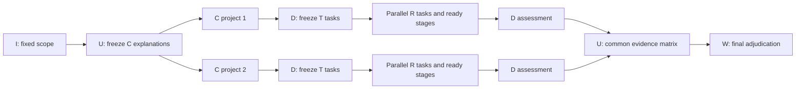

# Research methods and implementation

[English overview](../README.md) · [中文概览](../README.zh-CN.md) · [Data and tools](data_and_tools.md) · [Experiments](experiments.md)

## Scientific motivation

Scientific table analysis involves several decisions with different authority: fixing the object of study, identifying what remains unknown, selecting the next question, designing a calculation, executing it, and deciding what the result supports. The project represents these decisions explicitly instead of giving every role the same global conversation. Geochronology provides concrete cases where an age peak, a spatial trend and a geological event are related but require different evidential claims.

## I/U/P/D/R/W mainline

The [mixed implementation](../src/mix_epistemic_research_agent.py) uses a compiled outer LangGraph and an R subgraph. The model supplies scientific semantics through structured role contracts; Python assigns identities, validates structure, projects inputs and routes execution.

|Layer|Actual input and authority|Structured output|
|---|---|---|
|I — Interpretation|Raw question; registers research object, explicit boundaries and requested output. Code attaches the fixed epistemic policy.|`InterpretationOutput` → `InquiryConstitution`|
|U — Updater|Constitution; on subsequent cycles its prior snapshot and the new D report. Separates supported, challenged, uncertain and remaining-gap content.|`UpdaterOutput` → materialized `EpistemicSnapshot`|
|P — Planner|Constitution and U snapshot; selects exactly one existing open item ID.|`PlannerSelection` → local epistemic package|
|D — Department|Selected local item, constitution and R capability envelope; issues one bounded task per cycle. After R returns, states what is known and its boundary.|`DepartmentTaskDraft`, `DPlanReview`, `DepartmentResults`|
|R — Researcher|D-issued task, registered sources/tools, approved local DAG and scoped execution observations; chooses tools and their parameters.|`RTaskClaim`, `RPlanProposalDraft`, tool calls, `RProgressDecision`, `TechnicalResults`|
|W — Writer|Constitution and U's publication snapshot; writes the final answer from the current epistemic state.|`WriterOutput`|

Routing to W is based on whether U's map contains an open item. It is not a numerical confidence threshold. D issues a single task in a U/P cycle; further investigation requires a new U/P selection. See `build_graph`, `route_after_updater` and `route_after_department` in the mixed module, and the original [mixed tests](../work/test_mix_epistemic_research_agent.py).

## Local plan authorship and authorization

R first claims the exact D-generated task identity. It proposes a finite DAG with `stage_id`, an operation objective and dependencies. D reviews whether that proposal remains inside the task; D does not write or parameterize R's DAG. Only an approved proposal becomes the execution plan. Completed stages cannot be silently rewritten by a patch.

During execution R can issue a small batch of independent calls within a stage. It then chooses to continue, propose a topology patch or submit. Tool argument errors can return to the same stage for repair. The original checks cover rejected task claims, plan patches, D approval, finite DAG structure and parallel tool batches; these are behavioral checks of the real graph using scripted models.

## Context as a data-flow boundary

The mixed module retains scientific tool observations while projecting transient raw table and archive reads according to the dependency closure of the current DAG stage. A sibling read does not automatically become an input to another stage. Full transcripts remain audit records. The fixed-U R executor further uses stage artifacts and dependency packets for independent workers; its tests exercise independent-stage fan-out and delayed release of dependent stages.

This is implemented context selection, not a demonstrated reduction in hallucination. The evidence for the selection behavior is in `test_r_rolling_messages_keep_science_but_omit_data_and_archive_reads`, `test_data_and_archive_results_are_projected_only_by_dag_dependency`, and the fixed-U stage tests.

## Runtime-owned provenance

Scientific text and identity are separated. Actual tool calls create objective records; code attaches call IDs to technical packets, packet IDs to D reports and inherited references to U's items. In fixed-U, D's technical conclusions receive packet references from the matching frozen task; U's matrix must preserve every C explanation identity exactly once.

Hashes and references prove which stored artifact an output cites. They do not prove that an LLM's scientific interpretation is correct or that all relevant evidence has been acquired. Numerical routines and their input binding are checked separately from the model's interpretation.

## Latest local variant: fixed-U parallel explanation assessment

The active [fixed-U `build_graph`](../src/fixed_u_epistemic_research_agent.py) differs from the six-role mainline. U creates competing explanations once. Each C specifies predicted observations, counterevidence signals, required evidence and a decision target. D creates a frozen T table whose dimensions include support, counterevidence, discrimination and robustness. LangGraph `Send` dispatches C projects, T tasks and dependency-ready R stage waves. P is represented by deterministic routing rather than a model selection layer.

D reduces all expected T packets into a per-explanation assessment. Its `TechnicalBasis` preserves data scope, selection, sample size, grouping, methods, parameters, thresholds, statistics, uncertainty and robustness checks. U waits for every expected C, normalizes support and counterevidence into a common matrix, and records conflicts and unresolved items. The active W prompt assigns final scientific adjudication and the overall claim ceiling to W using that matrix. This is an intentional distinction from mixed W's publication of U's snapshot.

The file retains older private graph builders alongside its current public `build_graph`. Its shared policy text also contains older wording assigning W a narrower role than the active W prompt; that prompt-policy alignment remains a research maintenance question. The showcase preserves both rather than silently changing the experiment.

## What the project demonstrates

The code makes a research organization concrete through schemas, state projections, local execution plans, tool adapters, evidence references, persistence integration and controlled protocol tests. It also contains exploratory alternatives for iterative investigation versus fixed competing-explanation assessment. The present artifacts support implementation and experiment-design claims. Comparative scientific accuracy, convergence, efficiency and the benefit of either organization require further measurement on a fixed evaluation set.
